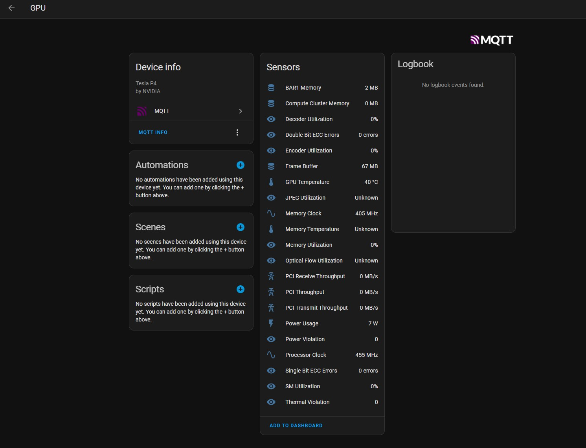

# NVidia Metrics to Home Assistant through MQTT

This project is a Python script that sends Nvidia GPU metrics to Home Assistant. It parses the output of the `nvidia-smi` command and uses Home Assistant's MQTT auto-discovery feature to register all GPUs. The service file will automatically install a virtual environment and the required package before execution. No root access is required.

## Features
- Sends Nvidia GPU metrics to Home Assistant
- Uses MQTT auto-discovery feature to register all GPUs
- Automatically installs a virtual environment and required package
- Per-sensor configurable report interval and aggregation (last/mean/median/max/min) via `config.yaml`, hot-reloaded



## Requirements
- Nvidia GPU
- Home Assistant
- MQTT broker

## Installation
1. Clone the repository to `$HOME/nvidia-stat`
2. Register and start the service: `systemctl --user enable $HOME/nvidia-stat/nvidia-smi2ha.service`
3. To start it at logon, make the user "linger": `loginctl enable-linger`
4. Make a copy of the `.env.sample` file as `.env`
5. Edit the credentials for the MQTT connection in `.env`
6. Start the service: `systemctl --user start nvidia-smi2ha.service`

## Usage
After installation, the script will start sending GPU metrics to your Home Assistant instance. You can view these metrics in the Home Assistant dashboard.

## Configuration

Reporting is controlled by `config.yaml` in the repository directory
(copy `config.yaml.example` to start). The file is watched and reloaded
automatically; no service restart is needed.

Each of the 21 sensors (`pwr gtemp mtemp sm mem enc dec jpg ofa mclk pclk
pci rxpci txpci pviol tviol fb bar1 ccpm sbecc dbecc`) can set:

- `interval` (seconds, >= 1) — how often the sensor reports
- `type` — `last`, `mean`, `median`, `max` or `min`; the value published is
  this aggregation over the samples collected during the interval
- `enabled: false` — stop registering the sensor entirely; the exporter
  publishes an empty config which removes the entity from Home Assistant

Sensors not listed use `defaults` (built-in: `interval: 10`, `type: last`).
Example: reporting the average power draw once per minute:

```yaml
sensors:
  pwr:
    interval: 60
    type: mean
```

## Troubleshooting
If you encounter any issues, please check the following:
- Ensure that the MQTT broker is running and accessible
- Check the `.env` file for any errors in the MQTT credentials

## Contributing
We welcome contributions! Please see the issues section for current tasks.

## License
This project is licensed under the MIT License.

## TODO
 - [ ] Code cleanup
 - [ ] Refactor to multiple files
 - [ ] Add configurable topics for the state updates and the HA sensor config